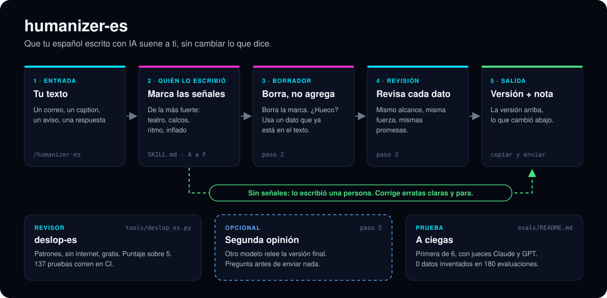
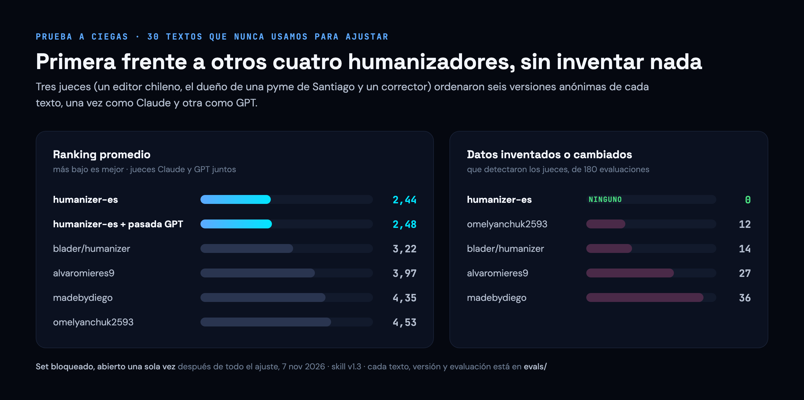

# humanizer-es

**Que tu español escrito con IA suene a ti, sin cambiar lo que dice.**

[English](README.md)

[](#resultados)
[](#resultados)
[](https://github.com/AIwithDiego/humanizer-es/actions/workflows/ci.yml)
[](https://github.com/AIwithDiego/humanizer-es/releases)


[](LICENSE)

[](#resultados)

```text
/plugin marketplace add AIwithDiego/humanizer-es
/plugin install humanizer-es@humanizer-es
```

Una skill para Claude Code, un prompt para pegar en cualquier chat y un revisor. La hice en Dublín con Claude Code, en noviembre de 2026. Quedó primera frente a otros cuatro humanizadores en una prueba a ciegas evaluada por Claude y por GPT; los jueces no encontraron ningún dato inventado en 180 evaluaciones.

**Funciona en:** Claude Code (skill) · ChatGPT, Claude.ai y cualquier chat ([`prompt.md`](prompt.md)) · cualquier terminal (el revisor)

**[Instálala](#úsala-tú-mismo)** · **[Mira los resultados](#resultados)** · [Cada evaluación](evals/README.md) (en inglés) · [Cuéntanos](#cuéntanos)

**Contenido:** [El problema](#el-problema) · [Investigación](#investigación) · [Qué hace](#qué-hace) · [Resultados](#resultados) · [Cómo se hizo](#cómo-se-hizo) · [Qué salió mal](#qué-salió-mal) · [Lo que aprendí](#lo-que-aprendí) · [Úsala tú mismo](#úsala-tú-mismo)

## El problema

Cada vez más español lo redactan ChatGPT y Claude: correos a clientes, captions de Instagram, avisos de trabajo, posts de LinkedIn. Quien lee lo nota rápido. El texto de IA en español tiene sus propias marcas, y casi ninguna es la del inglés:

- **Calcos del inglés:** "es importante destacar que", "en el mundo actual", Mayúsculas En Los Títulos.
- **Gramática y ritmo:** gerundios colgados ("…, garantizando frescura"), tríadas por todas partes, preguntas que se responden solas.
- **El español equivocado:** vosotros y giros de España en el correo de una tienda de Santiago.
- **Teatro:** "no solo X, creamos Y", elogios vacíos, "¡Te leo en los comentarios!".

El arreglo de siempre, "haz que suene más humano", lo empeora. En nuestra prueba, pedírselo así a ChatGPT o a Claude inventó o cambió datos en unas 4 de cada 10 evaluaciones.

Un texto que suena a IA cuesta confianza: el cliente se pregunta si alguien leyó su correo. Un humanizador que inventa cuesta más. Una versión que agrega una disculpa que el negocio nunca dio, o un "nos encantó la propuesta" que nadie dijo, no se le puede mandar a un cliente. Para una pyme, el dato es el mensaje: la hora, el precio, la dirección.

> Los humanizadores en español que existen hacen que el texto suene más humano y de paso cambian datos. Hicimos uno que suena a persona y no cambia nada que sea cierto.

## Investigación

**Qué existe.** Encontramos cuatro humanizadores en español en GitHub. Congelamos tres, más el de inglés que usábamos antes, tal como estaban publicados, para probarlos de forma justa ([`evals/contestants/`](evals/contestants/)). Para las marcas, partimos de la guía de Wikipedia [Signs of AI writing](https://en.wikipedia.org/wiki/Wikipedia:Signs_of_AI_writing) y del marco de blader/humanizer, y catalogamos las propias del español, ordenadas por fuerza: algunas bastan solas, otras cuentan solo cuando se juntan ([`SKILL.md`](skills/humanizer-es/SKILL.md)). Para saber cómo suena una persona, juntamos textos que escribieron chilenos antes de que existiera ChatGPT (foros, avisos de trabajo, el "quiénes somos" de una pastelería, noticias locales) como control. Un buen humanizador los deja casi intactos ([`evals/human-sources.md`](evals/human-sources.md)).

**Para quién es.** Para quien escribe en español por trabajo, partiendo por las pymes de Chile y Latinoamérica: la dueña que le responde a un cliente, quien sube las publicaciones de la tienda a Instagram. La mayoría usa ChatGPT, no Claude Code, así que junto a la skill va un prompt para pegar.

**Los límites que elegimos.** Cuatro reglas guían cada versión:

1. **Primero, decidir quién lo escribió.** Si no aparece ninguna marca de IA, el texto es de una persona: corrige erratas claras y para.
2. **Arreglar borrando, no adornando.** Se borra la marca. Si queda un hueco, se llena con un dato que ya está en el texto. Si no hay dato, se simplifica.
3. **Nunca agregar un dato.** Ni nombres, ni números, ni disculpas, ni promesas, ni adornos. Mismo alcance, misma fuerza.
4. **Español neutro que se lee bien en Chile.** Tú y ustedes; nada de vosotros ni voseo.

**Lo que no hice.**

| Decisión | Por qué | Lo que cuesta |
|---|---|---|
| Nunca agregar un dato, ni para sonar más humano | Un humanizador que inventa no sirve para un correo a un cliente | Menos color que alvaromieres9, que a veces los jueces encontraron más chileno |
| Una skill y un prompt para pegar, no solo la skill | La mayoría de quienes escriben en español usan ChatGPT | El prompt tiene menos controles y no tiene segunda pasada |
| Jueces de dos familias de modelos, no de una | Un modelo que juzga solo prefiere su propio estilo | El doble de costo, y las familias no se ponen de acuerdo sobre la segunda pasada con GPT, así que queda opcional |
| Un set de prueba bloqueado, abierto una sola vez | Para que el número del titular no esté ajustado a la prueba | Ya se usó; el próximo número necesita textos nuevos |
| Un revisor con patrones, sin modelo | Gratis, instantáneo, sin internet, corre en CI | No ve las marcas de tono: 12 de 30 textos de IA salieron limpios |

## Qué hace

Pegas un texto en español. La skill decide si lo escribió una persona o una IA, borra las marcas de IA sin agregar nada, revisa cada dato contra el original y te devuelve la versión nueva con una nota corta de lo que cambió.

| | Qué es | Dónde |
|---|---|---|
| **La skill** | El flujo completo para Claude Code: marcas por fuerza, borrador, autorrevisión y una segunda pasada opcional con GPT | [`skills/humanizer-es/`](skills/humanizer-es/SKILL.md) |
| **El prompt para pegar** | Un solo prompt para ChatGPT, Claude.ai o cualquier chat | [`prompt.md`](prompt.md) |
| **El revisor** | `deslop-es`: revisor de marcas de IA en español con patrones. Gratis, sin internet, puntaje sobre 5 | [`tools/deslop_es.py`](tools/deslop_es.py) |
| **La evidencia** | Cada encargo, texto, versión, prompt de juez y evaluación | [`evals/`](evals/README.md) |



1. **Marcar las señales** ([`SKILL.md`](skills/humanizer-es/SKILL.md), secciones A a F): teatro, calcos, gramática y ritmo, inflado, formato, restos del proceso. Las secciones A y B justifican un cambio con una sola aparición; las marcas más débiles cuentan solo en grupo.
2. **Borrador** (paso 2): borrar, llenar un hueco con un dato que ya está o simplificar. Los adornos también son datos.
3. **Revisión** (paso 3): cada afirmación contra el original, y además el alcance, la fuerza y las garantías que tranquilizan al lector.
4. **Segunda opinión** (paso 5, opcional): otro modelo relee la versión final, solo si dices que sí.
5. **Revisor** ([`tools/deslop_es.py`](tools/deslop_es.py)): cinco categorías, un punto cada una; devuelve código 1 bajo 5/5, así que sirve en CI.

## Resultados

<p align="center"></p>

30 textos escritos por IA y 4 escritos por personas, ninguno usado para ajustar; cada humanizador corrió tal como se publica. Se probó la v1.3; la v1.4 solo agrega la corrección de erratas en textos de personas, revisada en el set de desarrollo y sin nueva evaluación. El prompt para pegar le gana a pedir "haz que suene más humano" por unos dos puestos. Todo, evaluación por evaluación: [`evals/`](evals/README.md) (en inglés).

<p align="center"></p>

- **Automático.** El revisor tiene 137 pruebas. CI las corre en cada pull request, junto con una revisión de la estructura del plugin y un escaneo de secretos.
- **Evaluaciones a ciegas.** 9 rondas. Los jueces nunca saben quién escribió qué, y jueces de dos familias de modelos evalúan cada versión.
- **Manual.** Diego la probó con sus propios textos, fuera de los sets de prueba.
- **Sin hacernos trampa.** El número del titular sale de un set bloqueado que nadie leyó mientras ajustábamos.

## Cómo se hizo

La hice yo, Diego Bauer, con Claude Code. Puse la vara (ganarles a ciegas a los humanizadores en español que existen, sin inventar), decidí la variante, la privacidad y qué cuenta como dato, y la probé con mis propios textos. Claude escribió la mayor parte de la skill, del revisor y de los scripts de prueba. Antes de publicarla, una revisión de seguridad de IA revisó la segunda pasada (inyección de prompts, datos enviados a OpenAI) y qué podíamos publicar según cada licencia.

El trabajo se hizo en un repo privado de laboratorio; esta copia pública sale de ahí con un script que deja fuera los textos de personas que no podemos republicar y que se detiene ante cualquier filtración. El historial de abajo sigue el orden en que se construyó.

| Paso | Qué entró |
|---|---|
| [`1eb9d06`](https://github.com/AIwithDiego/humanizer-es/commit/1eb9d06) | La skill: marcas de IA en español por fuerza, el flujo, el registro chileno |
| [`25d1b17`](https://github.com/AIwithDiego/humanizer-es/commit/25d1b17) | Los otros humanizadores congelados tal como se publicaron, con créditos, para una prueba justa |
| [`d72a722`](https://github.com/AIwithDiego/humanizer-es/commit/d72a722) [`b4e16a9`](https://github.com/AIwithDiego/humanizer-es/commit/b4e16a9) | Un set de prueba realista: 30 encargos, textos de GPT y de Claude, un set de desarrollo y uno bloqueado, y textos de control escritos por personas |
| [`487c7c1`](https://github.com/AIwithDiego/humanizer-es/commit/487c7c1) | Evaluación a ciegas: etiquetas mezcladas, tres perfiles de juez, jueces Claude y GPT |
| [`b9f111e`](https://github.com/AIwithDiego/humanizer-es/commit/b9f111e) | v1.3, ajustada solo con el set de desarrollo: dejar lo que describe, mismo alcance y misma fuerza |
| [`c93a017`](https://github.com/AIwithDiego/humanizer-es/commit/c93a017) | `deslop-es`, el revisor, con 113 pruebas |
| [`ee21223`](https://github.com/AIwithDiego/humanizer-es/commit/ee21223) [`32fb078`](https://github.com/AIwithDiego/humanizer-es/commit/32fb078) | El prompt para pegar, probado contra un pedido simple |
| [`c0d63e6`](https://github.com/AIwithDiego/humanizer-es/commit/c0d63e6) | El set bloqueado, abierto una vez: primera con las dos familias de jueces, 0 datos inventados |
| [`a9ac9fe`](https://github.com/AIwithDiego/humanizer-es/commit/a9ac9fe) | v1.4: el texto de una persona solo recibe corrección de erratas |
| [`3f9114c`](https://github.com/AIwithDiego/humanizer-es/commit/3f9114c) [`9af920b`](https://github.com/AIwithDiego/humanizer-es/commit/9af920b) | Empaquetada como plugin de Claude Code; CI con las pruebas del revisor, la estructura del plugin y gitleaks |
| [#5](https://github.com/AIwithDiego/humanizer-es/pull/5) [#6](https://github.com/AIwithDiego/humanizer-es/pull/6) | Arreglos del revisor a partir de los primeros issues públicos, de un colaborador externo, [@X6M-Work](https://github.com/X6M-Work) |
| [#8](https://github.com/AIwithDiego/humanizer-es/pull/8) | v1.4.1: el español normal de México, Argentina, España y Colombia tiene que salir limpio |

## Qué salió mal

| | |
|---|---|
| **Nos pusimos nota a nosotros mismos.** Las tres primeras rondas usaron textos que habíamos escrito nosotros, así que decían poco. Las botamos y armamos una prueba con encargos reales, textos de GPT y de Claude, y textos que escribieron personas antes de ChatGPT. | [`d72a722`](https://github.com/AIwithDiego/humanizer-es/commit/d72a722) |
| **Por sonar humana, inventaba.** La v1.2 cambió o inventó datos en 21 evaluaciones del set de desarrollo, sobre todo detalles de producto que cortaba como relleno. Las reglas de alcance y fuerza bajaron la v1.3 a 3, y a 0 de 180 en el set bloqueado. | [`b9f111e`](https://github.com/AIwithDiego/humanizer-es/commit/b9f111e) |
| **GPT creía que su propio texto ya sonaba humano.** El primer prompt para pegar dejaba casi intactos los textos de GPT. La solución: decidir primero quién lo escribió y editar el texto de IA aunque se vea correcto. | [`32fb078`](https://github.com/AIwithDiego/humanizer-es/commit/32fb078) |
| **Dejar intacto el texto de una persona restaba puntos.** Los jueces pusieron primero a otro humanizador en los textos humanos porque corregía erratas. La v1.4 corrige erratas claras y nada más. | [`a9ac9fe`](https://github.com/AIwithDiego/humanizer-es/commit/a9ac9fe) |
| **El revisor leía "no solo" de forma muy estrecha.** Detectaba "no solo es X" pero no "no solo X, creamos Y". Reportado en [#2](https://github.com/AIwithDiego/humanizer-es/issues/2). | [#5](https://github.com/AIwithDiego/humanizer-es/pull/5) |
| **El gerundio colgado solo contaba al final del texto.** El revisor no lo veía al final de cualquier otra oración. Reportado en [#3](https://github.com/AIwithDiego/humanizer-es/issues/3). | [#6](https://github.com/AIwithDiego/humanizer-es/pull/6) |

## Lo que aprendí

- **El error grave es inventar, no sonar a robot.** Reglas como "deja lo que describe, borra el elogio vacío" y "mismo alcance, misma fuerza" sirvieron más que cualquier lista de palabras prohibidas.
- **Un modelo no ve sus propias mañas.** Por eso la skill decide quién escribió el texto antes de tocarlo, y por eso otro modelo puede releer el resultado.
- **Los jueces no opinan igual según la familia.** Los jueces Claude preferían nuestra versión sin la pasada de GPT; los jueces GPT, con ella. Con una sola familia habríamos sacado una conclusión equivocada y muy segura.
- **El set de prueba se bloquea y se abre una vez.** Un número ajustado con los mismos textos que reportas habla de tu ajuste, no de la herramienta.
- **Hay que llegar donde la gente ya escribe.** El prompt para pegar llega a quienes usan ChatGPT, y le gana a un pedido simple por unos dos puestos.
- **Otros ojos encuentran lo que las pruebas no.** Los tres primeros issues ya están resueltos, dos por un colaborador externo.

**Qué sigue:** las marcas que nos reportes, ejemplos para el revisor de más países (Perú, Venezuela, Uruguay…) y una nueva ronda a ciegas con textos nuevos, para evaluar la v1.4 y lo que cambie con tus comentarios.

## Cuéntanos

Este es un proyecto vivo. Cada aviso de que una versión cambió un dato, dejó una marca o sonó raro alimenta la próxima versión.

- **Una versión salió mal:** [abre un issue](https://github.com/AIwithDiego/humanizer-es/issues/new?template=rewrite.yml) (cambia nombres y números reales por otros inventados).
- **Una idea o un comentario rápido:** [déjanos tu comentario](https://github.com/AIwithDiego/humanizer-es/issues/new?template=feedback.yml).
- **¿Prefieres no usar GitHub?** Escríbeme por Instagram a [@ai_with_diego](https://www.instagram.com/ai_with_diego/) o a diego@aiwithdiego.com.

Los pull requests también son bienvenidos, sobre todo falsas alarmas del revisor con español normal de tu país. Ver [CONTRIBUTING.md](CONTRIBUTING.md). Problemas de seguridad: [SECURITY.md](SECURITY.md).

## Reglas de la casa

- **Ningún dato nuevo.** Ni datos, ni disculpas, ni promesas, ni personalidad que tu texto no tenga.
- **El texto de una persona sigue siendo suyo.** Corrige erratas y ahí para.
- **Edita para lectores, no para detectores.** Nunca promete pasar un detector de IA.
- **Nada sale sin preguntar.** Tu texto va a otro modelo solo si dices que sí.
- **No sirve para esconder el uso de IA.** Por favor, no la uses donde hay que declararlo (trabajos de estudio, investigación, periodismo).

## Úsala tú mismo

1. En Claude Code, corre las dos líneas de instalación de arriba.
2. Pega un texto en español y pídele a Claude que lo humanice, o escribe `/humanizer-es`.
3. Copia la versión de arriba. Debajo viene una nota con lo que cambió.
4. ¿No usas Claude Code? Pega [`prompt.md`](prompt.md) en ChatGPT o Claude.ai y después tu texto, debajo de "Texto:".
5. El revisor: `python3 tools/deslop_es.py --text "tu texto"` (Python 3, sin instalar nada).

## Mapa del repo

```
skills/humanizer-es/SKILL.md   la skill: marcas por fuerza, flujo, voz
prompt.md                      la versión para pegar en ChatGPT y Claude.ai
tools/deslop_es.py             el revisor; test_deslop_es.py tiene sus 137 pruebas
evals/                         encargos, textos, competidores congelados, prompts de juez, evaluaciones
  README.md                    cada ronda y sus números (en inglés)
  contestants/                 los otros humanizadores, congelados tal como se publicaron
docs/                          imágenes del README; docs/src/ las dibuja con HTML y Python
.claude-plugin/                manifiestos del plugin y del marketplace
```

## Créditos

Construida sobre ideas de [blader/humanizer](https://github.com/blader/humanizer), [stop-slop](https://github.com/hardikpandya/stop-slop), [SlopMonster](https://github.com/ItsssssJack/SlopMonster) y los humanizadores en español de [omelyanchuk2593](https://github.com/omelyanchuk2593/humanizer-es), [alvaromieres9](https://github.com/alvaromieres9/humanizer-es), [Milevan](https://github.com/Milevan/humanizer-es) y [madebydiego](https://github.com/madebydiego/humanizador). Arreglos del revisor de [@X6M-Work](https://github.com/X6M-Work). Detalle en [THIRD-PARTY.md](THIRD-PARTY.md).

## Licencia

MIT · Hecha en Dublín por [Diego Bauer](https://www.aiwithdiego.com) · [LinkedIn](https://www.linkedin.com/in/diego-bauer-domeyko/)

Un proyecto de [AIwithDiego](https://www.aiwithdiego.com). ¿Necesitas algo así para tu equipo? [Hablemos](https://www.aiwithdiego.com).
