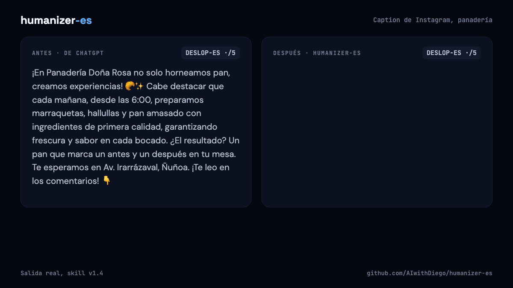
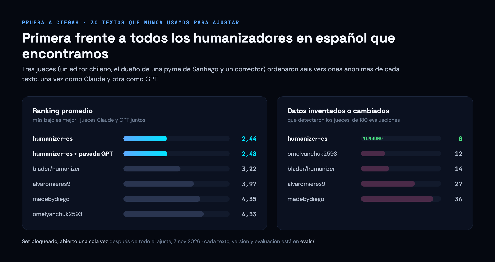

# humanizer-es

[English](README.md)

**Que tu español escrito con IA suene a ti, sin cambiar lo que dice.**

Primera frente a otros cuatro humanizadores en una prueba a ciegas evaluada por Claude y por GPT, con 0 datos inventados en 180 evaluaciones.

<sub>Hecha por [AIwithDiego](https://www.aiwithdiego.com). ¿La necesitas para tu equipo? [Hablemos](https://www.aiwithdiego.com).</sub>

<p align="center"></p>

```text
/plugin marketplace add AIwithDiego/humanizer-es
/plugin install humanizer-es@humanizer-es
```

**Funciona en:** Claude Code (skill) · ChatGPT, Claude.ai y cualquier chat ([`prompt.md`](prompt.md)) · cualquier terminal (el revisor)

## Por qué existe

El texto de IA en español tiene sus propias marcas: calcos del inglés, gerundios colgados, Mayúsculas De Título, español de España en el correo de una tienda chilena. Los humanizadores en español que encontramos arreglaban algunas e inventaban detalles para sonar humanos, como una disculpa que el cliente nunca pidió. Este arregla las marcas y mantiene cada dato.

## Cómo empezar

1. En Claude Code, corre las dos líneas de arriba.
2. Pega un texto en español y pídele a Claude que lo humanice, o escribe `/humanizer-es`.
3. Copia la versión de arriba. Debajo viene una nota con lo que cambió.

¿No usas Claude Code? Pega [`prompt.md`](prompt.md) en ChatGPT o Claude.ai y después tu texto, debajo de "Texto:". El revisor: `python3 tools/deslop_es.py --text "tu texto"`.

## Lo que no hace

- Agregar datos, disculpas, promesas o personalidad que tu texto no tiene.
- Reescribir un texto que escribió una persona. Corrige erratas y ahí para.
- Prometer que pasa los detectores de IA. Edita para lectores.
- Enviar tu texto a otro modelo sin preguntarte.
- Ayudar a esconder el uso de IA donde hay que declararlo (trabajos de estudio, investigación, periodismo).

## Resultados

<p align="center"></p>

30 textos escritos por IA y 4 escritos por personas, ninguno usado para ajustar; cada humanizador corrió tal como se publica. El prompt para pegar le gana a pedir "haz que suene más humano" por unos dos puestos. Todo, evaluación por evaluación: [`evals/`](evals/README.md) (en inglés).

---

## Decisiones

| Decisión | Por qué | Lo que cuesta |
|---|---|---|
| Nunca agregar un dato, ni para sonar más humano | Un humanizador que inventa no sirve para un correo a un cliente | Menos color que alvaromieres9, que a veces los jueces encontraron más chileno |
| Una skill y un prompt para pegar | La mayoría de quienes escriben en español usan ChatGPT, no Claude Code | El prompt tiene menos controles y no tiene segunda pasada |
| Jueces de dos familias de modelos | Un modelo que juzga solo prefiere su propio estilo | El doble de costo, y las familias no se ponen de acuerdo sobre la segunda pasada con GPT, así que queda opcional |
| Un set de prueba bloqueado, abierto una sola vez | Para que el número del titular no esté ajustado a la prueba | Ya se usó; el próximo número necesita textos nuevos |
| Un revisor con patrones, sin modelo | Gratis, instantáneo, sin internet, corre en CI | No ve las marcas de tono: 12 de 30 textos de IA salieron limpios |

## Cómo se hizo

La hice yo, Diego Bauer, con Claude Code. Puse la vara (ganarle a ciegas a todos los humanizadores en español que encontramos, sin inventar), decidí la variante, la privacidad y qué cuenta como dato, y la probé con mis propios textos. Claude escribió la mayor parte de la skill, del revisor y de los scripts de prueba. Antes de publicarla, una revisión de seguridad de IA revisó la segunda pasada (inyección de prompts, datos enviados a OpenAI) y qué podíamos publicar legalmente.

## Lo que aprendí

- **Un modelo no ve sus propias mañas.** El primer prompt para pegar dejaba casi intacto el texto de GPT: GPT muchas veces decidía que su propio texto "ya suena humano". La solución fue decidir primero quién lo escribió y editar el texto de IA aunque se vea correcto.
- **El error grave es inventar, no sonar a robot.** La v1.2 cambió o inventó datos en 21 evaluaciones del set de desarrollo; la v1.3 en 3, y en 0 de 180 en el set bloqueado. Reglas como "deja lo que describe, borra el elogio vacío" y "mismo alcance, misma fuerza" sirvieron más que cualquier lista de palabras prohibidas.
- **Los jueces no opinan igual según la familia.** Los jueces Claude preferían nuestra versión sin la pasada de GPT; los jueces GPT, con ella. Con una sola familia habríamos sacado una conclusión equivocada y muy segura.
- **Dejar intacto el texto de una persona no basta.** Los jueces pusieron primero a otro humanizador en los textos humanos porque corregía erratas. La v1.4 corrige erratas claras y nada más.
- **Botamos nuestras tres primeras rondas de prueba** porque los textos los habíamos escrito nosotros. Desde entonces la prueba usa encargos reales, textos de GPT y de Claude, y textos que escribieron personas antes de ChatGPT.

## Contribuir

Los issues y pull requests son bienvenidos, sobre todo falsas alarmas del revisor con español normal de tu país. Ver [CONTRIBUTING.md](CONTRIBUTING.md). Problemas de seguridad: [SECURITY.md](SECURITY.md).

## Créditos

Construida sobre ideas de [blader/humanizer](https://github.com/blader/humanizer), [stop-slop](https://github.com/hardikpandya/stop-slop), [SlopMonster](https://github.com/ItsssssJack/SlopMonster) y los humanizadores en español de [omelyanchuk2593](https://github.com/omelyanchuk2593/humanizer-es), [alvaromieres9](https://github.com/alvaromieres9/humanizer-es), [Milevan](https://github.com/Milevan/humanizer-es) y [madebydiego](https://github.com/madebydiego/humanizador). Detalle en [THIRD-PARTY.md](THIRD-PARTY.md).

## Licencia

MIT · Hecha en Dublín por [Diego Bauer](https://www.aiwithdiego.com) · [LinkedIn](https://www.linkedin.com/in/diego-bauer-domeyko/)
