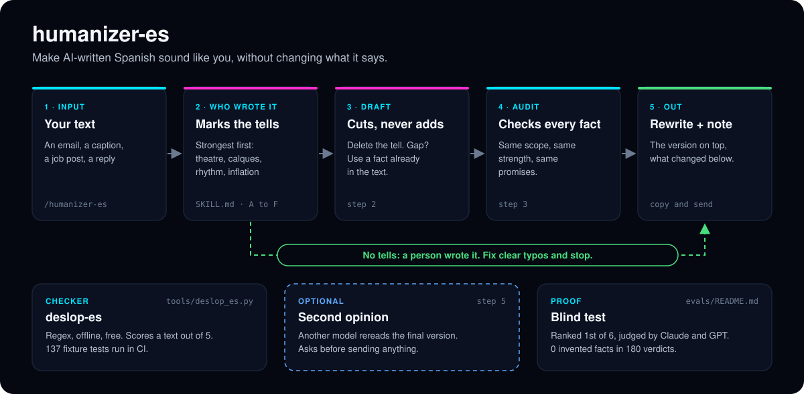
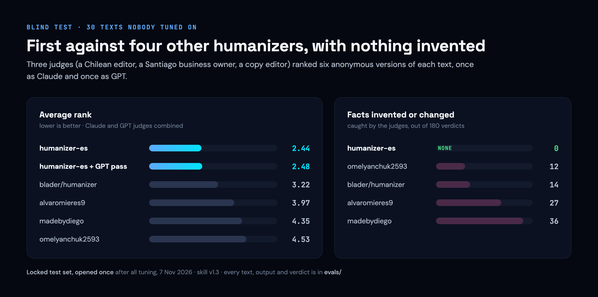

# humanizer-es

**Make AI-written Spanish sound like you, without changing what it says.**

[Español](README.es.md)

[](#results)
[](#results)
[](https://github.com/AIwithDiego/humanizer-es/actions/workflows/ci.yml)
[](https://github.com/AIwithDiego/humanizer-es/releases)


[](LICENSE)

[](#results)

```text
/plugin marketplace add AIwithDiego/humanizer-es
/plugin install humanizer-es@humanizer-es
```

A Claude Code skill, a paste-in prompt for any chat, and a checker. Built in Dublin with Claude Code, November 2026. Ranked first against four other humanizers in a blind test judged by Claude and GPT; the judges caught 0 invented facts in 180 verdicts.

**Works with:** Claude Code (skill) · ChatGPT, Claude.ai and any chat ([`prompt.md`](prompt.md)) · any terminal (the checker)

**[Install it](#run-it-yourself)** · **[See the results](#results)** · [Every verdict](evals/README.md) · [Send feedback](#send-feedback)

**Contents:** [The problem](#the-problem) · [Research](#research) · [What it does](#what-it-does) · [Results](#results) · [The build](#the-build) · [What went wrong](#what-went-wrong) · [What I learned](#what-i-learned) · [Run it yourself](#run-it-yourself)

## The problem

More and more Spanish is drafted by ChatGPT and Claude: client emails, Instagram captions, job posts, LinkedIn updates. Readers spot it fast. Spanish AI text has its own tells, and most of them aren't the English ones:

- **Calques from English:** "es importante destacar que", "en el mundo actual", Title Case En Los Títulos.
- **Grammar and rhythm:** dangling gerunds ("…, garantizando frescura"), triads everywhere, questions that answer themselves.
- **The wrong Spanish:** vosotros and Spain phrasing in an email from a shop in Santiago.
- **Theatre:** "no solo X, creamos Y", empty praise, "¡Te leo en los comentarios!".

The usual fix, "make it sound more human", makes it worse. In our test, a plain ask to ChatGPT or Claude invented or changed facts in about 4 of every 10 verdicts.

A text that sounds like AI costs trust: the client wonders whether anyone read their email. A humanizer that invents costs more. A rewrite that adds an apology the business never made, or "we loved the proposal" when nobody said so, can't go to a client. For a small business, the fact is the whole point of the message: the hour, the price, the address.

> The Spanish humanizers out there make text sound more human and change facts along the way. We built one that sounds like a person and changes nothing that's true.

## Research

**What already exists.** We found four Spanish humanizers on GitHub. We froze three of them, plus the English one we used before, exactly as published, to test them fairly later ([`evals/contestants/`](evals/contestants/)). For the tells, we started from Wikipedia's [Signs of AI writing](https://en.wikipedia.org/wiki/Wikipedia:Signs_of_AI_writing) and blader/humanizer's framework, then catalogued the Spanish ones and ranked them by strength: some are enough on their own, others count only in clusters ([`SKILL.md`](skills/humanizer-es/SKILL.md)). For what a person sounds like, we collected texts Chileans wrote before ChatGPT existed (forum posts, job ads, a pastry shop's "about us", local news) as controls. A good humanizer leaves them almost untouched ([`evals/human-sources.md`](evals/human-sources.md)).

**Who it's for.** People who write Spanish for work, starting with small businesses in Chile and Latin America: the owner answering a client, the person posting the shop's Instagram. Most of them use ChatGPT, not Claude Code, so a paste-in prompt ships next to the skill.

**The limits we chose.** Four rules shape every rewrite:

1. **Decide who wrote it first.** If no AI tell shows up, the text is a person's: fix clear typos and stop.
2. **Fix by deleting, not decorating.** Cut the tell. If that leaves a gap, fill it with a fact already in the text. If there's none, simplify.
3. **Never add a fact.** No new names, numbers, apologies, promises or flourishes. Same scope, same strength.
4. **Neutral Spanish that reads right in Chile.** Tú and ustedes; no vosotros, no voseo.

**What I didn't build.**

| Choice | Why | Trade-off |
|---|---|---|
| Never add a fact, even to sound more human | A humanizer that invents can't be trusted with a client email | Less colourful than alvaromieres9, which judges sometimes found more Chilean |
| A skill and a paste-in prompt, not a skill alone | Most people who write in Spanish use ChatGPT | The prompt has fewer checks and no second pass |
| Judges from two model families, not one | A model judging alone favours its own style | Twice the cost, and the families disagree on the GPT second pass, so it stays optional |
| A locked test set, opened once | So the headline number isn't tuned to the test | It's spent; the next claim needs new texts |
| A regex checker, no model | Free, instant, offline, runs in CI | Misses tells of tone: 12 of 30 AI texts scored clean |

## What it does

Paste a Spanish text. The skill decides whether a person or an AI wrote it, cuts the AI tells without adding anything, checks every fact against the original, and hands back the rewrite with a short note on what changed.

| | What it is | Where |
|---|---|---|
| **The skill** | Full workflow for Claude Code: tells ranked by strength, a draft, a self-audit, an optional second pass by GPT | [`skills/humanizer-es/`](skills/humanizer-es/SKILL.md) |
| **The paste-in prompt** | One prompt for ChatGPT, Claude.ai or any chat | [`prompt.md`](prompt.md) |
| **The checker** | `deslop-es`: regex checker for Spanish AI tells. Free, offline, scores a text out of 5 | [`tools/deslop_es.py`](tools/deslop_es.py) |
| **The evidence** | Every brief, text, version, judge prompt and verdict | [`evals/`](evals/README.md) |



1. **Mark the tells** ([`SKILL.md`](skills/humanizer-es/SKILL.md), sections A to F): theatre, calques, grammar and rhythm, inflation, format, process leftovers. Sections A and B justify a change on one sighting; weaker tells count only in clusters.
2. **Draft** (step 2): delete, fill a gap with a fact already there, or simplify. Flourishes count as facts.
3. **Audit** (step 3): every claim against the original, plus scope, strength and the guarantees that reassure the reader.
4. **Second opinion** (step 5, optional): another model rereads the final version, only after you say yes.
5. **Checker** ([`tools/deslop_es.py`](tools/deslop_es.py)): five categories, one point each; exit code 1 below 5/5, so it fits in CI.

## Results

<p align="center"></p>

30 AI-written texts and 4 written by people, none used for tuning; each humanizer ran as it ships. Tested on v1.3; v1.4 only adds typo fixes on text a person wrote, checked on the dev set and not re-judged. The paste-in prompt beats a plain "make it sound human" by about two ranks. Everything, verdict by verdict: [`evals/`](evals/README.md).

<p align="center"></p>

- **Automated.** The checker has 137 fixture tests. CI runs them on every pull request, with a plugin structure check and a secret scan.
- **Blind evals.** 9 rounds. Judges never see who wrote what, and judges from two model families score every version.
- **Manual.** Diego tested it on his own texts, outside the test sets.
- **Honest about the test.** The headline number comes from a locked set nobody read while tuning.

## The build

Built by Diego Bauer with Claude Code. I set the bar (beat the Spanish humanizers out there, blind, without inventing), made the calls on variant, privacy and what counts as a fact, and tested it on my own texts. Claude wrote most of the skill, the checker and the test scripts. Before release, an AI security review covered the second pass (prompt injection, data sent to OpenAI) and what we could publish under each licence.

The work happened in a private lab repo; this public copy is built from it with a script that leaves out the human texts we can't republish and fails on any leak. The history below follows the build order.

| Step | What landed |
|---|---|
| [`1eb9d06`](https://github.com/AIwithDiego/humanizer-es/commit/1eb9d06) | The skill: Spanish AI tells ranked by strength, the workflow, the Chilean register |
| [`25d1b17`](https://github.com/AIwithDiego/humanizer-es/commit/25d1b17) | The other humanizers frozen as published, with credits, for a fair test |
| [`d72a722`](https://github.com/AIwithDiego/humanizer-es/commit/d72a722) [`b4e16a9`](https://github.com/AIwithDiego/humanizer-es/commit/b4e16a9) | A realistic test set: 30 briefs, texts from GPT and Claude, a dev/locked split, and human controls |
| [`487c7c1`](https://github.com/AIwithDiego/humanizer-es/commit/487c7c1) | Blind judging: shuffled labels, three personas, Claude and GPT judges |
| [`b9f111e`](https://github.com/AIwithDiego/humanizer-es/commit/b9f111e) | v1.3, tuned on dev only: keep descriptors, same scope and strength |
| [`c93a017`](https://github.com/AIwithDiego/humanizer-es/commit/c93a017) | `deslop-es`, the checker, with 113 fixture checks |
| [`ee21223`](https://github.com/AIwithDiego/humanizer-es/commit/ee21223) [`32fb078`](https://github.com/AIwithDiego/humanizer-es/commit/32fb078) | The paste-in prompt, tested against a plain ask |
| [`c0d63e6`](https://github.com/AIwithDiego/humanizer-es/commit/c0d63e6) | The locked set, opened once: first with both judge families, 0 invented facts |
| [`a9ac9fe`](https://github.com/AIwithDiego/humanizer-es/commit/a9ac9fe) | v1.4: text a person wrote gets typo fixes only |
| [`3f9114c`](https://github.com/AIwithDiego/humanizer-es/commit/3f9114c) [`9af920b`](https://github.com/AIwithDiego/humanizer-es/commit/9af920b) | Packaged as a Claude Code plugin; CI with checker tests, plugin structure and gitleaks |
| [#5](https://github.com/AIwithDiego/humanizer-es/pull/5) [#6](https://github.com/AIwithDiego/humanizer-es/pull/6) | Checker fixes from the first public issues, by an outside contributor, [@X6M-Work](https://github.com/X6M-Work) |
| [#8](https://github.com/AIwithDiego/humanizer-es/pull/8) | v1.4.1: normal Spanish from Mexico, Argentina, Spain and Colombia must score clean |

## What went wrong

| | |
|---|---|
| **We graded our own homework.** The first three test rounds used texts we had written ourselves, so they told us little. We retired them and built a test from real briefs, GPT and Claude texts, and texts people wrote before ChatGPT. | [`d72a722`](https://github.com/AIwithDiego/humanizer-es/commit/d72a722) |
| **Sounding human, it invented.** v1.2 changed or invented facts in 21 verdicts on the dev set, mostly product details cut as filler. Rules on scope and strength brought v1.3 to 3, and to 0 of 180 on the locked set. | [`b9f111e`](https://github.com/AIwithDiego/humanizer-es/commit/b9f111e) |
| **GPT thought its own text already sounded human.** The first paste-in prompt left GPT's texts almost untouched. The fix: decide first who wrote it, and edit AI text even when it looks correct. | [`32fb078`](https://github.com/AIwithDiego/humanizer-es/commit/32fb078) |
| **Leaving human text alone lost points.** Judges ranked a competitor first on human texts because it fixed typos. v1.4 fixes clear typos and nothing else. | [`a9ac9fe`](https://github.com/AIwithDiego/humanizer-es/commit/a9ac9fe) |
| **The checker read "no solo" too narrowly.** It caught "no solo es X" but missed "no solo X, creamos Y". Reported in [#2](https://github.com/AIwithDiego/humanizer-es/issues/2). | [#5](https://github.com/AIwithDiego/humanizer-es/pull/5) |
| **A dangling gerund only counted at the very end.** The checker missed one at the end of any other sentence. Reported in [#3](https://github.com/AIwithDiego/humanizer-es/issues/3). | [#6](https://github.com/AIwithDiego/humanizer-es/pull/6) |

## What I learned

- **Inventing is the real failure, not sounding robotic.** Rules like "keep descriptors, cut empty praise" and "same scope, same strength" did more than any list of banned words.
- **A model can't see its own habits.** That's why the skill decides who wrote a text before touching it, and why a second model can reread the result.
- **Judges disagree by family.** Claude judges preferred our version without the GPT pass; GPT judges preferred it with. One family would have given us a confident wrong answer.
- **Lock the test set and open it once.** Every number tuned on the same texts you report is a number about your tuning.
- **Ship where people already write.** The paste-in prompt reaches the people on ChatGPT, and it beats a plain ask by about two ranks.
- **Outside eyes find what fixtures don't.** The first three issues are fixed, two of them by an outside contributor.

**What's next:** tells you report, checker fixtures from more countries (Peru, Venezuela, Uruguay…), and a new blind round on fresh texts to judge v1.4 and whatever your feedback changes.

## Send feedback

This is a live project. Every report that a rewrite changed a fact, missed a tell or sounded off feeds the next version.

- **A rewrite went wrong:** [open an issue](https://github.com/AIwithDiego/humanizer-es/issues/new?template=rewrite.yml) (swap real names and numbers for made-up ones).
- **An idea or a quick note:** [share feedback](https://github.com/AIwithDiego/humanizer-es/issues/new?template=feedback.yml).
- **Rather not use GitHub?** Send a DM on Instagram to [@ai_with_diego](https://www.instagram.com/ai_with_diego/) or email diego@aiwithdiego.com.

Pull requests are welcome too, especially false alarms from the checker on normal Spanish from your country. See [CONTRIBUTING.md](CONTRIBUTING.md). Security issues: [SECURITY.md](SECURITY.md).

## Ground rules

- **No new facts.** No facts, apologies, promises or personality that aren't in your text.
- **A person's text stays theirs.** It fixes typos and stops.
- **It edits for readers, not detectors.** It never promises to beat an AI detector.
- **Nothing leaves without asking.** Your text goes to another model only if you say yes.
- **Not for hiding AI use.** Please don't use it where you have to declare AI (coursework, research, journalism).

## Run it yourself

1. In Claude Code, run the two install lines at the top.
2. Paste a Spanish text and ask Claude to humanize it, or type `/humanizer-es`.
3. Copy the version on top. Under it, a note on what changed.
4. No Claude Code? Paste [`prompt.md`](prompt.md) into ChatGPT or Claude.ai, then your text after "Texto:".
5. The checker: `python3 tools/deslop_es.py --text "tu texto"` (Python 3, no installs).

## Repo map

```
skills/humanizer-es/SKILL.md   the skill: tells by strength, workflow, voice
prompt.md                      the paste-in version for ChatGPT and Claude.ai
tools/deslop_es.py             the checker; test_deslop_es.py holds its 137 fixture checks
evals/                         briefs, texts, frozen contestants, judge prompts, verdicts
  README.md                    every round and its numbers
  contestants/                 the other humanizers, frozen as published
docs/                          README images; docs/src/ draws them from HTML and Python
.claude-plugin/                plugin and marketplace manifests
```

## Credits

Built on ideas from [blader/humanizer](https://github.com/blader/humanizer), [stop-slop](https://github.com/hardikpandya/stop-slop), [SlopMonster](https://github.com/ItsssssJack/SlopMonster) and the Spanish humanizers by [omelyanchuk2593](https://github.com/omelyanchuk2593/humanizer-es), [alvaromieres9](https://github.com/alvaromieres9/humanizer-es), [Milevan](https://github.com/Milevan/humanizer-es) and [madebydiego](https://github.com/madebydiego/humanizador). Checker fixes by [@X6M-Work](https://github.com/X6M-Work). Details in [THIRD-PARTY.md](THIRD-PARTY.md).

## Licence

MIT · Made in Dublin by [Diego Bauer](https://www.aiwithdiego.com) · [LinkedIn](https://www.linkedin.com/in/diego-bauer-domeyko/)

Built by [AIwithDiego](https://www.aiwithdiego.com). Need something like this for your team? [Talk to me](https://www.aiwithdiego.com).
