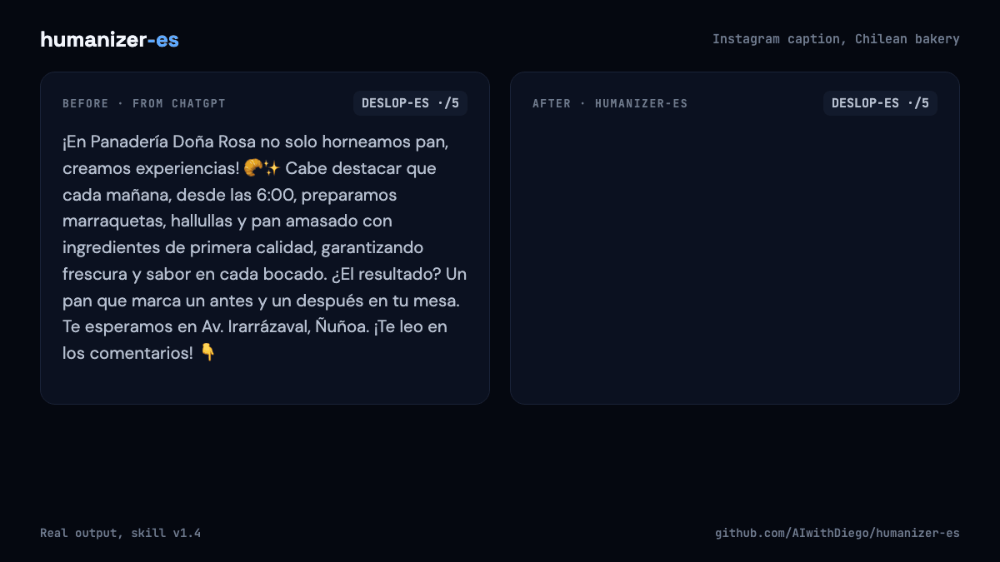
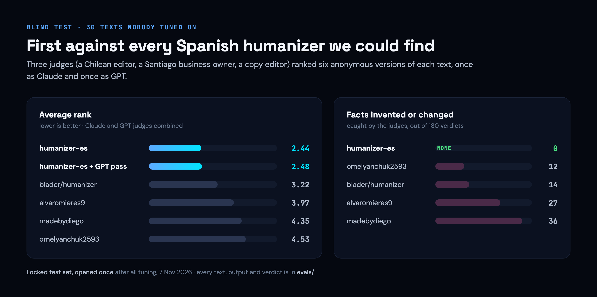

# humanizer-es

[Español](README.es.md)

**Make AI-written Spanish sound like you, without changing what it says.**

Ranked first against four other humanizers in a blind test judged by Claude and GPT, with 0 invented facts in 180 verdicts.

<sub>Built by [AIwithDiego](https://www.aiwithdiego.com). Need this for your team? [Talk to me](https://www.aiwithdiego.com).</sub>

<p align="center"></p>

```text
/plugin marketplace add AIwithDiego/humanizer-es
/plugin install humanizer-es@humanizer-es
```

**Works with:** Claude Code (skill) · ChatGPT, Claude.ai and any chat ([`prompt.md`](prompt.md)) · any terminal (the checker)

## Why this exists

AI text in Spanish has its own tells: calques from English, dangling gerunds, Title Case, Spain Spanish in a Chilean shop's email. The Spanish humanizers we found fixed some of them and invented details to sound human, like an apology the client never made. This one fixes the tells and keeps every fact.

## Quick start

1. In Claude Code, run the two lines above.
2. Paste a Spanish text and ask Claude to humanize it, or type `/humanizer-es`.
3. Copy the version on top. Under it, a note on what changed.

No Claude Code? Paste [`prompt.md`](prompt.md) into ChatGPT or Claude.ai, then your text after "Texto:". Checker: `python3 tools/deslop_es.py --text "tu texto"`.

## What it won't do

- Add facts, apologies, promises or personality that aren't in your text.
- Rewrite text a person wrote. It fixes typos and stops.
- Promise to beat AI detectors. It edits for readers.
- Send your text to another model without asking.
- Help hide AI use where you must declare it (coursework, research, journalism).

## Results

<p align="center"></p>

30 AI-written texts and 4 written by people, none used for tuning; each humanizer ran as it ships. The paste-in prompt beats a plain "make it sound human" by about two ranks. Everything, verdict by verdict: [`evals/`](evals/README.md).

---

## Decisions

| Choice | Why | Trade-off |
|---|---|---|
| Never add a fact, even to sound more human | A humanizer that invents can't be trusted with a client email | Less colourful than alvaromieres9, which judges sometimes found more Chilean |
| A skill and a paste-in prompt | Most people who write in Spanish use ChatGPT, not Claude Code | The prompt has fewer checks and no second pass |
| Judges from two model families | A model judging alone favours its own style | Twice the cost, and the families disagree on the GPT second pass, so it stays optional |
| A locked test set, opened once | So the headline number isn't tuned to the test | It's spent; the next claim needs new texts |
| A regex checker, no model | Free, instant, offline, runs in CI | Misses tells of tone: 12 of 30 AI texts scored clean |

## How this was built

Built by Diego Bauer with Claude Code. I set the bar (beat every Spanish humanizer we could find, blind, without inventing), made the calls on variant, privacy and what counts as a fact, and tested it on my own texts. Claude wrote most of the skill, the checker and the test scripts. Before release, an AI security review covered the second pass (prompt injection, data sent to OpenAI) and what we could legally publish.

## What I learned

- **A model can't see its own habits.** The first paste-in prompt left GPT's text almost untouched: GPT often decided its own text "ya suena humano". The fix was to decide first who wrote it, and edit AI text even when it looks correct.
- **Inventing is the real failure, not sounding robotic.** v1.2 changed or invented facts in 21 verdicts on the dev set; v1.3 in 3, and in 0 of 180 on the locked set. Rules like "keep descriptors, cut empty praise" and "same scope, same strength" did more than any list of banned words.
- **Judges disagree by family.** Claude judges preferred our version without the GPT pass; GPT judges preferred it with. Testing with one family would have given us a confident wrong answer.
- **Leaving human text alone isn't enough.** Judges ranked a competitor first on human texts because it fixed typos. v1.4 fixes clear typos and nothing else.
- **We retired our first three test rounds** because we had written the texts ourselves. The test since uses real briefs, texts from GPT and Claude, and texts people wrote before ChatGPT.

## Contributing

Issues and pull requests welcome, especially false alarms from the checker on normal Spanish from your country. See [CONTRIBUTING.md](CONTRIBUTING.md). Security issues: [SECURITY.md](SECURITY.md).

## Credits

Built on ideas from [blader/humanizer](https://github.com/blader/humanizer), [stop-slop](https://github.com/hardikpandya/stop-slop), [SlopMonster](https://github.com/ItsssssJack/SlopMonster) and the Spanish humanizers by [omelyanchuk2593](https://github.com/omelyanchuk2593/humanizer-es), [alvaromieres9](https://github.com/alvaromieres9/humanizer-es), [Milevan](https://github.com/Milevan/humanizer-es) and [madebydiego](https://github.com/madebydiego/humanizador). Details in [THIRD-PARTY.md](THIRD-PARTY.md).

## License

MIT · Made in Dublin by [Diego Bauer](https://www.aiwithdiego.com) · [LinkedIn](https://www.linkedin.com/in/diego-bauer-domeyko/)
